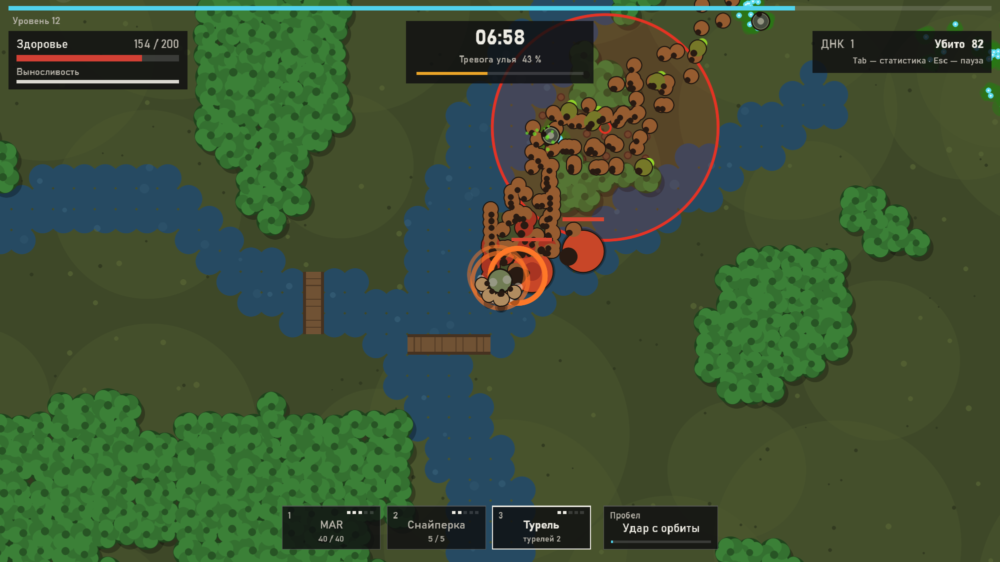
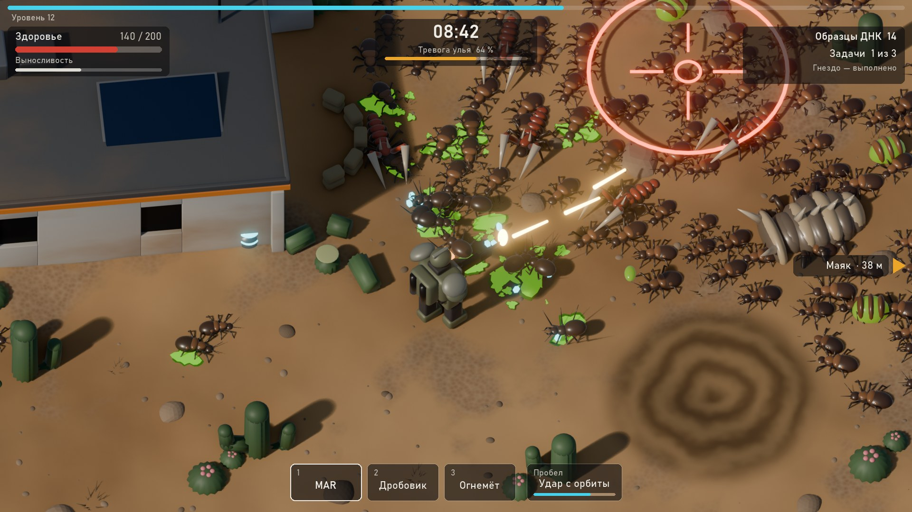

# StarRun


**StarRun** — top-down выживалка на Python в духе военной фантастики: десантник
высаживается на заражённую колонию, отстреливается от сотен жуков, растёт в уровнях,
выбирает улучшения и уходит на эвакуационном челноке. Забег — 12–18 минут:
его длину задаёт шкала «Тревога улья», а не таймер.

**Документация:** [руководство оператора](docs/operator-guide.md) ·
[справочник по классам](docs/classes.md) ·
[дизайн и баланс](docs/design.md)



---

## Содержание

- [Возможности](#возможности)
- [Производительность](#производительность)
- [Установка и запуск](#установка-и-запуск)
- [Управление](#управление)
- [Настройка баланса](#настройка-баланса)
- [Тесты и CI](#тесты-и-ci)
- [Архитектура](#архитектура)
- [Дорожная карта](#дорожная-карта)

---

## Возможности

Версия 0.0.4 — ядро игры и карта (этапы 1–3) на простых фигурах: круги вместо спрайтов,
без звука. Механика и баланс уже настоящие: восемь видов жуков, семь стволов
с модификациями, удар с орбиты, четыре биома с лесом под топор и постройками.

**Карта и биомы**
- Карта 8000 × 8000 px (200 × 200 клеток по 40 px), высадка в центре на поляне.
  Биомы по кругу: пустыня → густой лес → джунгли → болото; «Ещё забег» — следующий.
- Лес непроходим и закрывает линию огня. Упёрся в дерево — десантник рубит его топором;
  лес выжигают взрывы, удар с орбиты и огнемёт, танкер и боссы проламывают.
- Пустыня: кактусы колются, зыбучий песок затягивает и замедляет. Джунгли: реки
  с мостами. Болото: топь замедляет всех наземных.
- Постройки колонистов: двери открываются перед десантником, окна и заборы —
  перелезть; крыша прозрачна, когда десантник внутри. Если он укрылся, жуки
  выламывают двери и лезут в окна.
- Жуки идут к десантнику в обход препятствий по полю путей; летающие — напрямую.
- Находки: аптечки, магниты, образцы ДНК, ящики с оружием в постройках
  и подствольный гранатомёт для MAR — его не выбрать карточкой, только найти.

**Забег**
- Жуки появляются за краем экрана; численность растёт от 40 до 320 к 12-й минуте,
  каждую минуту — налёт колонной с одной стороны. Новые виды вливаются в толпу
  по одному: воин со 2-й минуты, стрелок с 4-й, летающие с 6-й, танкер с 8-й,
  мозговой с 10-й. Отставших рой переносит вперёд по ходу движения.
- Каждую минуту жуки получают +8 % здоровья и +5 % урона.
- Шкала «Тревога улья» растёт со временем и от убийства полубоссов; при 100 %
  (не раньше 12-й минуты) выходит королева. После её гибели — эвакуация:
  60 секунд в зоне посадки челнока.

**Жуки**

| Жук | Чем опасен |
|---|---|
| Рабочий | Толпа, кусает при касании |
| Воин | Удар после замаха 0,8 с — можно отбежать |
| Стрелок | Держит дистанцию 320 px, плюётся кислотой, перед плевком раздувает мешок |
| Летающий | Быстрый, стаями по 5–8, петляет на подлёте |
| Танкер | Броня −3 к каждому попаданию, не отбрасывается |
| Мозговой | Держится позади, аура: жуки рядом +25 % к скорости и урону |
| Полубосс | 5, 10, 15-я минута: рывки, призыв рабочих |
| Королева | Залпы кислоты веером, призыв свиты |

**Оружие** — до трёх стволов, стреляет выбранный (1–3 или колесо мыши), перезарядка
остальных идёт в фоне. Новый ствол — карточкой на уровне, пока есть свободный слот.
Улучшения ствола поднимают его уровень до 5-го, на 5-м — карточка модификации.

| Ствол | Роль | Модификация |
|---|---|---|
| MAR | Ровный урон по прямой | Подствольный гранатомёт (находка на карте) |
| Дробовик | Веер дроби вблизи, отбрасывает | Зажигательная дробь |
| Снайперская винтовка | Бьёт самого живучего, пробивает 3 | Рельса — пробивает всех |
| Огнемёт | Конус огня, поджигает | Напалм — горящие лужи |
| Тактическая ракетница | Взрыв в гуще толпы | Кассета — 4 малых заряда |
| Мини-турель | Ставится сама и стреляет 20 с | Пара турелей |
| Шокер | Молния по цепи из 4 целей | Шторм — 8 целей, оглушение |

Пробел — удар с орбиты: метка под курсором, через 1,5 с взрыв по площади.
Автонаведение держит цель до её гибели; босс в приоритете, если рядом никто не кусает.

**Развитие**
- Кристаллы опыта притягиваются в радиусе подбора. На новом уровне — выбор
  из трёх карточек: хотя бы одна для оружия и одна пассивная.
- Шесть редкостей — от обычной (+7 %) до мифической (+33 %).
- 35 улучшений: 6 для десантника, 6 для всего оружия и удара с орбиты,
  по 3–4 для каждого ствола; плюс карточки новых стволов и модификаций.

**Интерфейс**
- HUD: опыт, здоровье, выносливость, время, тревога улья, образцы ДНК, три слота
  оружия с уровнем и патронами, слот способности, стрелки к боссам и зоне эвакуации.
- Пауза (Esc), статистика десантника (Tab) — с оружием и тем, кто ранил больше всего,
  итоги забега.
- Мир всегда виден в масштабе 1080 строк по высоте — на любом мониторе
  одинаковый обзор; интерфейс подстраивается под пропорции экрана.

## Производительность

Ryzen 7 8745HS / Radeon 780M, окно 1600×900, Windows 11:

| Сцена | Время кадра |
|---|---|
| 410 жуков, королева, полубосс, брызги, HUD — в среднем | 5,5 мс |
| то же, 99-й процентиль | 10 мс |
| Огнемёт с напалмом, ракеты с кассетой, турели, все виды жуков — в среднем | 7,3 мс |
| то же, 99-й процентиль | 12 мс |
| Симуляция мира (без отрисовки), 420 жуков | ~1,1 мс |
| На карте (густой лес): тяжёлое оружие, королева, полубосс — в среднем | 9,0 мс |
| то же, 99-й процентиль | 12,6 мс |
| Из них симуляция / отрисовка карты | 3,3 мс / ~1,5 мс |
| Спайк этапа 0: 1000 жуков, только круги | 2,9 мс (~290 FPS) |

Требование ТЗ — 300–400 врагов при 60 FPS в 1080p (16,7 мс на кадр) —
выполняется с запасом.

## Установка и запуск

Требования: Windows 10/11 x64, видеокарта с OpenGL 3.3,
[uv](https://docs.astral.sh/uv/) (Python 3.13 он скачает сам).

```bash
git clone https://github.com/Alexey-Izilianov/StarRun.git
cd StarRun
uv sync
uv run starrun              # на весь экран
uv run starrun --windowed   # в окне; --seed 42 — повторить забег
uv run starrun --biome jungle   # начать с джунглей; plain — ровная земля без карты
```

Без uv: Python 3.13, `python -m venv .venv`, `.venv\Scripts\pip install -e .`,
`.venv\Scripts\python -m starrun`. Python 3.14 пока не подходит: у pymunk
(зависимость Arcade) нет для него сборок.

Готовая сборка `.exe` появится на этапе 6.

## Управление

| Действие | Клавиши |
|---|---|
| Движение | WASD / стрелки |
| Бег (тратит выносливость) | Shift |
| Рубить дерево | идти в него |
| Удар с орбиты под курсор | Пробел |
| Выбор ствола | 1–3 или колесо мыши |
| Выбор улучшения (на экране уровня) | 1–3 или мышь |
| Пауза / статистика | Esc / Tab |
| Полный экран / окно | F11 |
| Новый забег (следующий биом) после итогов | Enter или кнопка «Ещё забег» |

## Настройка баланса

Все числа игры — в `data/*.toml`, код их только читает. Опечатка в ключе
или ссылка на несуществующую характеристику — ошибка при запуске, а не тихая
поломка.

| Файл | Что в нём |
|---|---|
| `data/player.toml` | характеристики десантника, потолки, выносливость |
| `data/enemies.toml` | жуки и боссы, рост силы по минутам |
| `data/weapons.toml` | семь стволов с модификациями и удар с орбиты |
| `data/session.toml` | тревога улья, полубоссы, эвакуация, спавн и состав толпы, опыт, редкости |
| `data/upgrades.toml` | улучшения за уровень |
| `data/biomes.toml` | карта (размер, рубка, двери, окна, песок, топь, кактусы), находки, четыре биома |

Проверить баланс без игры — бот-игрок проходит забеги за десятки секунд:

```bash
uv run python tools/balance_bot.py --runs 6               # биомы по кругу
uv run python tools/balance_bot.py --runs 6 --biome plain  # ровная земля
```

Бот обходит лес, но пути не ищет и на картах держится заметно меньше,
чем на ровной земле: выводы о сложности карт — только после живой игры.

## Тесты и CI

pytest, 91 тест на логику без графики (~19 с): загрузка и проверка данных,
опыт и редкости, ход забега и выход королевы, спавн и состав толпы, стаи, укусы,
замах воина, стрелки, аура мозгового, броня, оглушение, отбрасывание, каждый ствол
и каждая модификация, слоты и карточки оружия, удар с орбиты, боссы, кристаллы,
полные забеги с детерминированным зерном, эвакуация; карта — генерация всех биомов,
стены и вода держат десантника, рубка, песок, кактусы, окна и заборы, двери,
находки, обход препятствий жуками, выламывание дверей, пули и кислота в стенах,
линия огня, выжигание леса, спавн за экраном на свободных клетках, зона эвакуации.

```bash
uv run pytest -q
uv run ruff check src tests tools
uv run mypy src/starrun/sim src/starrun/balance.py
```

GitHub Actions ([ci.yml](.github/workflows/ci.yml)): на Windows — ruff, mypy, тесты
и два коротких забега ботом.

## Архитектура

```
src/starrun/balance.py  data/*.toml → неизменяемые dataclass, проверка связей
src/starrun/sim/        мир без графики: карта, толпа, оружие, эффекты, опыт, ход забега, спавн
src/starrun/ui/         отрисовка (инстансинг), HUD и оверлеи, окно и ввод
data/                   баланс
tests/                  pytest
tools/                  бот для баланса, рендер референсной сцены в Blender
spikes/                 прототип производительности этапа 0
```

- **Толпа — массивы NumPy**, а не объекты: каждая характеристика (позиция, здоровье,
  кулдаун…) — один массив на всех жуков. 400 жуков обновляются без цикла Python.
  Расталкивание — через сетку плотности, O(N), без попарных расстояний.
- **Отрисовка — инстансинг**: все круги слоя уходят в видеокарту одним буфером
  и одним вызовом. Спайк показал разницу: SpriteList на 400 объектов — 44 FPS,
  инстансинг — 330. Тексты HUD рисуются одним пакетом pyglet.
- **Пули проверяются отрезком**, а не точкой: снайперская пуля пролетает 40+ пикселей
  за кадр и иначе проскакивала бы жука насквозь.
- **Карта — сетка NumPy** 200 × 200: вид клетки, почва, прочность, номер постройки.
  Жуки идут по **полю путей**: обход в ширину масками NumPy от клетки десантника
  в окне 73 × 49 клеток, направление в каждой клетке — к соседу ближе к цели.
  Обход (~2 мс) разнесён на несколько кадров, чтобы не давать пиков.
- **Линия огня**: цель выбирается среди видимых жуков, от ближних к дальним пачками;
  пули, ракеты и кислота гаснут в стенах и лесу (проверка отрезка полёта).
- **Симуляция отделена от графики**: `World.step(dt, Controls)` — чистая логика
  со своим генератором случайных чисел, поэтому забег воспроизводится по зерну
  и целиком проверяется тестами.

## Дорожная карта

| Этап | Содержание | Состояние |
|---|---|---|
| 0 | Технологии и прототип производительности | готово |
| 1 | Ядро геймплея на простых фигурах | готово |
| 2 | Все жуки и все 7 видов оружия, слоты 1–3 | готово |
| 3 | Карта, прорубаемый лес, постройки, четыре биома, находки | готово, проверка |
| 4 | Арт (Blender → спрайты 8 направлений) и звук | |
| 5 | Мета-прогрессия: образцы ДНК, корабль-база | |
| 6 | Меню, настройки, сохранения, сборка `.exe` | |

Концепт следующих этапов и референсная сцена — [docs/design.md](docs/design.md).



## Лицензия

Не определена: все права сохранены за автором.
