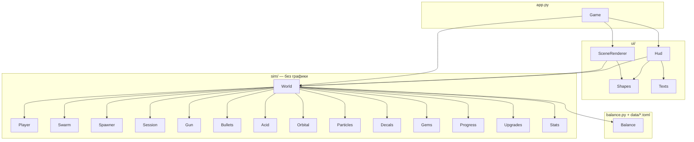

# StarRun — справочник по классам

Документ для разработчика: из каких модулей и классов состоит игра, за что отвечает
каждый и как они связаны. Сигнатуры — в исходниках (`src/starrun/**/*.py`), здесь —
их смысл и правила использования.

## Содержание

1. [Слои и связи](#1-слои-и-связи)
2. [Общие правила](#2-общие-правила)
3. [Данные — `balance.py`](#3-данные--balancepy)
4. [Симуляция — `sim/`](#4-симуляция--sim)
5. [Отрисовка и интерфейс — `ui/`](#5-отрисовка-и-интерфейс--ui)
6. [Окно — `app.py`](#6-окно--apppy)
7. [Инструменты и тесты](#7-инструменты-и-тесты)
8. [Как добавить…](#8-как-добавить)

---

## 1. Слои и связи

Слои зависят только «вниз»: `sim/` не импортирует Arcade и ничего не знает
об экране; `ui/` читает состояние мира, но не меняет его; связывает всё `Game`.

## 2. Общие правила

**Единицы.** Расстояния — пиксели экрана 1080p (мир всегда виден на 1080 px
по высоте), время — секунды, доли — от 0 до 1. Ось Y направлена вверх.

**Числа — только в данных.** Баланс читается из `data/*.toml` через `Balance`;
в коде остаются лишь технические константы (размер клетки сетки, предел шага
`MAX_DT`, доли спавна в фазах).

**Массовые объекты — структура массивов.** Жуки, пули, плевки, брызги, пятна
и кристаллы — классы с массивами NumPy на всю ёмкость (`pos`, `hp`, `alive`…).
Живые отмечены маской `alive`; новые занимают свободные ячейки. Цикл Python
по объектам — только для единиц (боссы, метки удара с орбиты).

**Случайность.** У мира один генератор `World.rng`, его получают все части симуляции.
Одинаковое зерно и одинаковые `Controls` — одинаковый забег (это проверяют тесты).

**Шаг мира.** Всё меняется только в `World.step(dt, controls)`. Шаг ограничен
`MAX_DT` = 1/30 с, чтобы при подвисании кадра пули и жуки не проскакивали друг
сквозь друга. На паузе, при выборе улучшения и после конца забега `step` ничего не делает.

**События.** За шаг мир складывает в `World.events` строки о случившемся
(`"shot"`, `"kill"`, `"player_hit"`, `"level_up"`, `"semi_boss"`, `"queen"`, `"evac"`,
`"blast"`, `"victory"`, `"defeat"`…). Интерфейс показывает по ним сообщения
и трясёт камеру; на этапе 4 по ним же пойдут звуки.

---

## 3. Данные — `balance.py`

Загружает `data/*.toml` в неизменяемые (`frozen`) dataclass и проверяет связи
между файлами.

| Класс / функция | Назначение |
|---|---|
| `Balance.load(folder=None)` | Читает пять файлов, собирает `Balance`, вызывает `validate()`. Папка по умолчанию — `data_dir()` |
| `Balance.validate()` | Обязательные жуки на месте; улучшения ссылаются на существующие характеристики; `mode`/`group` допустимы; `id` уникальны |
| `data_dir()` | `data/` рядом с исходниками или внутри собранного `.exe` (`sys._MEIPASS`) |
| `_build(cls, raw)` | Собирает dataclass из таблицы TOML; неизвестный ключ — `ValueError` с его именем |
| `PlayerCfg`, `Stamina` | Базовые характеристики десантника, потолки, выносливость |
| `EnemyCfg`, `Scaling` | Параметры жука (общие и особые для воина, полубосса, королевы), рост по минутам |
| `WeaponCfg`, `OrbitalCfg` | MAR и удар с орбиты |
| `AlertCfg`, `EvacCfg`, `SpawnCfg`, `XpCfg` | Тревога, эвакуация, спавн, кривая опыта |
| `Rarity`, `Upgrade` | Редкость и описание улучшения |

---

## 4. Симуляция — `sim/`

Чистый Python + NumPy, без Arcade. Покрыто тестами `tests/test_*.py`.

### `world.World`
Забег целиком. Создаёт и связывает все части симуляции.

| Член | Назначение |
|---|---|
| `step(dt, controls)` | Один шаг: движение → удар с орбиты → события сессии (выпуск боссов) → спавн и перенос отставших → толпа (укусы, призывы, залпы) → стрельба → попадания → взрывы → смерти (опыт, брызги, пятна, тревога, эвакуация) → кристаллы и уровни → эвакуация и смерть десантника |
| `awaiting_choice` | Есть невыбранные улучшения — шаг стоит |
| `offer()` / `choose(i)` | Три карточки текущего уровня (кэшируются до выбора) и их применение; улучшение здоровья добавляет прибавку к текущему |
| `pick_target(reach)` | Цель MAR: ближайший жук с «залипанием» (`TARGET_SWITCH`) и приоритетом боссов, если ближе `BOSS_FOCUS` никто не кусает |
| `nearest_boss(reach)` | Ближайший полубосс или королева в радиусе |
| `events`, `blasts` | Что случилось за последний шаг; взрывы удара с орбиты для отрисовки |
| `kills`, `damage_dealt`, `damage_taken` | Статистика забега |
| `evac_pos`, `target` | Центр зоны эвакуации (после королевы); текущая цель MAR |

### `world.Controls`, `world.Player`
`Controls` — ввод за кадр: направление движения, бег, точка удара с орбиты (если в
этом кадре нажат пробел). `Player` — позиция, здоровье, выносливость, направление
взгляда; `move()` двигает, тратит и восстанавливает выносливость, лечит регенерацией;
`take_hit()` бросает уклонение и снимает здоровье.

### `swarm.Swarm`
Все жуки в массивах. Вид — индекс в `KINDS` (`WORKER`, `WARRIOR`, `SEMI_BOSS`, `QUEEN`).

| Метод | Назначение |
|---|---|
| `spawn(kind, pos, hp_mult, damage_mult)` | Занимает свободные ячейки, задаёт параметры вида с учётом роста по минутам; скорость — ±10 % для живости толпы |
| `step(dt, player, radius)` → `SwarmStep` | Движение к десантнику, расталкивание, выталкивание с круга десантника, укусы, замах воина, рывки и призывы полубосса, залпы и призывы королевы |
| `separation(pos, center)` | Сетка плотности 100×70 клеток по 32 px вокруг десантника: жуки скатываются по градиенту плотности. O(N) вместо попарных расстояний |
| `hit(idx, amounts)` / `collect_dead()` | Урон (с подсветкой) и снятие убитых; данные убитых остаются в массивах до следующего спавна в ячейку |
| `nearest`, `in_radius`, `far_from` | Запросы для прицела, взрывов и переноса отставших |

`SwarmStep` — результат шага толпы: удары по десантнику, призывы (где и сколько),
точки залпов, число завершённых замахов.

### `combat`
| Класс | Назначение |
|---|---|
| `Gun` | Темп и магазин MAR: `update()` возвращает число выстрелов за кадр, сам начинает перезарядку. Без цели темп не копится |
| `Bullets` | Пули десантника: полёт, срок жизни (дальность / скорость), попадание в ближайшего жука на пути, пробитие (`pierce`), защита от повторного удара по тому же жуку (`last_hit`) |
| `Acid` | Плевки королевы: летят по прямой, бьют десантника при касании |
| `Orbital`, `Mark` | Удар с орбиты: `trigger()` ставит метку (не дальше `max_range`), `update()` возвращает сработавшие метки; перезарядка делится на `orbital_rate` |
| `fan(direction, count, spread)` | Направления веером — для залпа королевы |

### `effects`
`Particles` — брызги (разлёт, торможение, угасание). `Decals` — пятна крови
в кольцевом буфере на 700 штук, выцветают за 25 с. `Gems` — кристаллы опыта:
в радиусе подбора притягиваются и долетают даже после ухода десантника;
при переполнении опыт прибавляется к лежащим кристаллам, а не теряется.

### `progression`
| Член | Назначение |
|---|---|
| `Stats` | Характеристики: `(база + прибавки) × множители`, с потолками из `[caps]`; `stats["имя"]` |
| `xp_to_next(level, cfg)`, `Progress` | Кривая опыта; `Progress.add()` может дать несколько уровней сразу, они копятся в `pending` |
| `Upgrades.offer(rng)` | Три разные карточки: одна для оружия, одна пассивная, третья любая; редкость на каждую своя; исчерпанные по `max_rank` не предлагаются |
| `Upgrades.apply(offer, stats)` | `mult` — множитель `1 + бонус`; `add` — `value × бонус / бонус_обычной`, у целых — округление вверх |
| `Offer.amount()`, `roll_rarity()` | Размер эффекта карточки; бросок редкости по весам |

### `session.Session`, `session.Phase`
Ход забега: время, рост жуков (`hp_mult`, `damage_mult`, `boss_hp_mult`), тревога,
полубоссы по минутам, фазы `WAVE → QUEEN → EVAC → VICTORY` или `DEFEAT`.
`update()` возвращает события `"semi_boss"` и `"queen"`, мир выпускает по ним боссов.
`evac_tick()` считает секунды только внутри зоны.

### `spawner`
`Spawner.update()` возвращает пачки «вид → позиции» на кадр: доводит численность до
целевой (`target_population`) не быстрее `max_per_second`, раз в минуту выпускает
налёт с одной стороны, долю воинов берёт из `warrior_share`. `edge_positions()` —
точки на периметре экрана, расширенного на `margin`; `front_side()` — сторона
по ходу движения (туда переносят отставших).

---

## 5. Отрисовка и интерфейс — `ui/`

### `render.Shapes`
Пакет фигур для одного инстансного вызова: круги и кольца (`add`, `add_one`),
прямоугольники и рамки (`rect`, `outline`). Экземпляр — 10 чисел: центр, размер,
цвет RGBA, толщина кольца, признак круга. Шейдер сглаживает край круга по `fwidth`.
`flush()` отправляет накопленное в видеокарту и рисует; при переполнении
буфера (20 000) сбрасывает сам. Фигуры рисуются в порядке добавления — порядок
вызовов и есть порядок слоёв.

### `scene.SceneRenderer`
Мир на простых фигурах: камушки на земле (детерминированные по клеткам 256 px —
чтобы движение было видно), пятна-кляксы, зона эвакуации с заполнением, метки
удара с орбиты, кристаллы, плевки, жуки (тень боссов, контур, тело с подсветкой
попадания, голова в сторону десантника, кольцо замаха воина), десантник,
пули с хвостом, брызги, вспышки взрывов, полоски здоровья боссов. Всё за один `flush()`.

### `hud.Hud`
Интерфейс в координатах 1080 по высоте, ширина `vw` — по пропорциям окна.

| Метод | Назначение |
|---|---|
| `draw(world, vw, world_to_ui)` | HUD: опыт, здоровье, выносливость, время, тревога / королева / эвакуация, убитые, слоты, стрелки к целям за краем, сообщения |
| `level_up`, `pause`, `stats`, `end` | Оверлеи поверх затемнения; кнопки и карточки регистрируются в `buttons` |
| `click(x, y)` | Нажатие по кнопке или карточке |
| `notify(text)` | Сообщение под временем на 3 с |

`Texts` — метки одного слоя в общем `pyglet.graphics.Batch`: создаются один раз
по ключу, рисуются одним вызовом в `flush()`, не обновлённые в кадре прячутся.
Два слоя — HUD (`t`) и оверлеи (`o`), чтобы текст оверлея был поверх затемнения.
Отдельный `arcade.Text.draw()` на метку стоил ~0,1 мс — 3,5 мс на HUD.

---

## 6. Окно — `app.py`

`Game(arcade.Window)` — окно, две камеры и состояния.

- **Камеры.** `world_cam` следует за десантником (с тряской при попадании и взрыве),
  `ui_cam` неподвижна. Обе проецируют 1080 px по высоте и `vw = 1080 × ширина / высота`
  по ширине (`_fit_cameras`, пересчёт в `on_resize`).
- **Состояния.** `Mode.PLAY / PAUSE / STATS`; поверх них — выбор улучшения
  (`world.awaiting_choice`) и итоги (`world.session.over`). Мир шагает только в `PLAY`
  без выбора и итогов.
- **Ввод.** Зажатые клавиши — в `held`, из них собирается `Controls`; пробел ставит
  флаг, точка удара — курсор, переведённый в мир через `world_cam.unproject`.
  Потеря фокуса окна сбрасывает клавиши и ставит паузу.
- `main()` — разбор `--windowed` и `--seed`, запуск. Точки входа — `python -m starrun`
  и скрипт `starrun` из `pyproject.toml`.

---

## 7. Инструменты и тесты

| Файл | Назначение |
|---|---|
| `tests/test_balance.py` | Загрузка данных, отказ на опечатке и неверной характеристике |
| `tests/test_progression.py` | Кривая опыта, несколько уровней разом, `Stats`, карточки, веса редкостей, применение и потолок улучшений |
| `tests/test_session.py` | Выход королевы на 18-й минуте и раньше при убийстве полубоссов, нижняя граница 12 мин, рост жуков, эвакуация, смерть |
| `tests/test_spawner.py` | Спавн за краем, налёт с одной стороны и раз в минуту, рост численности, воины, сторона по ходу движения |
| `tests/test_combat.py` | Прицел, укусы, замах воина, пробитие, магазин, удар с орбиты, боссы, веер, кристаллы |
| `tests/test_world.py` | Две минуты игры ботом, детерминизм по зерну, бег, смерть в толпе, королева → эвакуация → победа, отставшие, приоритет босса |
| `tools/balance_bot.py` | Бот-игрок: прогон забегов без окна и сводка по минутам, уровням и победам |
| `tools/refscene/` | Референсная сцена в Blender (`scene.py`) и HUD поверх неё (`hud.py`) |
| `spikes/perf_crowd.py` | Прототип производительности этапа 0 |

---

## 8. Как добавить…

**Характеристику десантника.** Ключ в `[stats]` в `data/player.toml` (и при нужде потолок
в `[caps]`), чтение — `world.stats["ключ"]` там, где она влияет. Название для окна
статистики — в `ui/hud.STAT_NAMES`.

**Улучшение.** Таблица `[[upgrade]]` в `data/upgrades.toml`; код менять не нужно,
если характеристика уже существует.

**Вид жука.** Раздел в `data/enemies.toml`, поля в `EnemyCfg`, имя в `swarm.KINDS`;
поведение — в `Swarm.step` маской по виду (как замах воина). Если жук должен появляться
в толпе — доля в `Spawner._split`.

**Оружие** (этап 2): раздел в `data/weapons.toml` и класс по образцу `Gun` + свой пул
снарядов по образцу `Bullets`; выбор слота — в `World` и `Game.on_key_press`.
