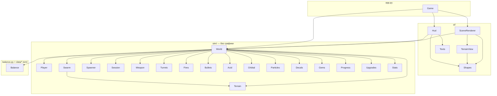

# StarRun — справочник по классам

Документ для разработчика: из каких модулей и классов состоит игра, за что отвечает
каждый и как они связаны. Сигнатуры — в исходниках (`src/starrun/**/*.py`), здесь —
их смысл и правила использования.

## Содержание

1. [Слои и связи](#1-слои-и-связи)
2. [Общие правила](#2-общие-правила)
3. [Данные — `balance.py`](#3-данные--balancepy)
4. [Симуляция — `sim/`](#4-симуляция--sim)
5. [Отрисовка и интерфейс — `ui/`](#5-отрисовка-и-интерфейс--ui)
6. [Окно — `app.py`](#6-окно--apppy)
7. [Инструменты и тесты](#7-инструменты-и-тесты)
8. [Как добавить…](#8-как-добавить)

---

## 1. Слои и связи

Слои зависят только «вниз»: `sim/` не импортирует Arcade и ничего не знает
об экране; `ui/` читает состояние мира, но не меняет его; связывает всё `Game`.

## 2. Общие правила

**Единицы.** Расстояния — пиксели экрана 1080p (мир всегда виден на 1080 px
по высоте), время — секунды, доли — от 0 до 1. Ось Y направлена вверх.

**Числа — только в данных.** Баланс читается из `data/*.toml` через `Balance`;
в коде остаются лишь технические константы (размер клетки сетки, предел шага
`MAX_DT`, доли спавна в фазах).

**Массовые объекты — структура массивов.** Жуки, пули, плевки, брызги, пятна
и кристаллы — классы с массивами NumPy на всю ёмкость (`pos`, `hp`, `alive`…).
Живые отмечены маской `alive`; новые занимают свободные ячейки. Цикл Python
по объектам — только для единиц (боссы, метки удара с орбиты).

**Случайность.** У мира один генератор `World.rng`, его получают все части симуляции.
Одинаковое зерно и одинаковые `Controls` — одинаковый забег (это проверяют тесты).

**Шаг мира.** Всё меняется только в `World.step(dt, controls)`. Шаг ограничен
`MAX_DT` = 1/30 с, чтобы при подвисании кадра пули и жуки не проскакивали друг
сквозь друга. На паузе, при выборе улучшения и после конца забега `step` ничего не делает.

**События.** За шаг мир складывает в `World.events` строки о случившемся
(`"shot_<ствол>"`, `"kill"`, `"player_hit"`, `"level_up"`, `"semi_boss"`, `"queen"`, `"evac"`,
`"blast"`, `"explosion"`, `"spit"`, `"turret"`, `"switch"`, `"victory"`, `"defeat"`…). Интерфейс показывает по ним сообщения
и трясёт камеру; на этапе 4 по ним же пойдут звуки.

---

## 3. Данные — `balance.py`

Загружает `data/*.toml` в неизменяемые (`frozen`) dataclass и проверяет связи
между файлами.

| Класс / функция | Назначение |
|---|---|
| `Balance.load(folder=None)` | Читает пять файлов, собирает `Balance`, вызывает `validate()`. Папка по умолчанию — `data_dir()` |
| `Balance.validate()` | Обязательные жуки на месте; улучшения ссылаются на существующие характеристики; `mode`/`group` допустимы; `id` уникальны |
| `data_dir()` | `data/` рядом с исходниками или внутри собранного `.exe` (`sys._MEIPASS`) |
| `_build(cls, raw)` | Собирает dataclass из таблицы TOML; неизвестный ключ — `ValueError` с его именем |
| `PlayerCfg`, `Stamina` | Базовые характеристики десантника, потолки, выносливость |
| `EnemyCfg`, `Scaling` | Параметры жука: общие и особые (замах, дистанция, броня, аура, стаи, лимит, рывки, залпы) — у кого не нужно, 0; рост по минутам |
| `WeaponCfg`, `OrbitalCfg` | Ствол: общие поля и особые (дробины, конус, пробитие, взрыв, горение, цепь, турели) плюс `mod_*` модификации; удар с орбиты |
| `AlertCfg`, `EvacCfg`, `SpawnCfg`, `MixCfg`, `XpCfg` | Тревога, эвакуация, спавн, доля вида в толпе по минутам, кривая опыта |
| `Rarity`, `Upgrade` | Редкость и описание улучшения; `Upgrade.weapon` — ствол, к которому оно относится |
| `ENEMY_KINDS`, `WEAPON_IDS` | Порядок видов (индекс — номер в массивах толпы, боссы последними) и обязательные стволы |

---

## 4. Симуляция — `sim/`

Чистый Python + NumPy, без Arcade. Покрыто тестами `tests/test_*.py`.

### `world.World`
Забег целиком. Создаёт и связывает все части симуляции. `World(balance, seed, biome)`:
с биомом — карта `Terrain` и десантник в её центре; без биома (`None`) — бесконечная
ровная земля, как на этапах 1–2 (так проверяются бой и баланс без карты).

| Член | Назначение |
|---|---|
| `step(dt, controls)` | Один шаг: движение (замедление окном, забором, топью и песком — `_slow`) → карта (`_on_map`: стены выталкивают, двери, топор, песок, кактусы, находки, поле путей) → выбор ствола → удар с орбиты → события сессии (выпуск боссов) → спавн (с лимитом видов) и перенос отставших → толпа (укусы, плевки, призывы, залпы) → перезарядка всех стволов, стрельба выбранного, турели, напалм, горение → попадания (`resolve`) → взрывы удара с орбиты → смерти (опыт, брызги, пятна, тревога, эвакуация) → кристаллы и уровни → эвакуация и смерть десантника |
| `weapons`, `active`, `weapon` | Стволы в слотах (до `SLOTS` = 3), номер выбранного, сам выбранный |
| `select(slot)`, `owned()` | Сменить ствол; стволы для подбора карточек: id → (уровень, модификация) |
| `awaiting_choice` | Есть невыбранные улучшения — шаг стоит |
| `offer()` / `choose(i)` | Три карточки текущего уровня (кэшируются до выбора) и их применение: новый ствол встаёт в слот и сразу в руки, улучшение ствола поднимает его уровень, модификация включает `Weapon.mod`; улучшение здоровья добавляет прибавку к текущему |
| `pick_target(reach)` | Цель выбранного ствола (запоминается в `target`): ближайший жук с «залипанием» (`TARGET_SWITCH`) и приоритетом боссов, если ближе `BOSS_FOCUS` никто не кусает |
| `nearest_boss(reach)` | Ближайший полубосс или королева в радиусе |
| `deal(idx, amounts, armor)` | Урон по жукам через `Swarm.hit`; в статистику идёт нанесённый с учётом брони |
| `resolve(impacts)` | Последствия полёта пуль: урон, отбрасывание (`KNOCK_STEP`), поджог, взрывы |
| `events`, `blasts`, `booms`, `arcs` | Что случилось за последний шаг; взрывы удара с орбиты, взрывы ракет и гранат, молнии шокера — для отрисовки |
| `kills`, `damage_dealt`, `damage_taken`, `damage_by` | Статистика забега; `damage_by` — полученный урон по источникам (вид жука или `"acid"`) |
| `turrets`, `fires`, `flames` | Поставленные турели, лужи напалма, частицы пламени |
| `evac_pos` | Центр зоны эвакуации (после королевы); на карте — открытое место, лес вокруг вырублен (`_evac_point`) |
| `terrain`, `biome` | Карта забега или `None` |
| `item_pos`, `item_kind`, `item_alive`, `dna` | Находки карты и собранные образцы ДНК |
| `nearest_bug(origin, reach)`, `toughest_bug` | Ближайший / самый живучий жук на линии огня — все стволы и турели целятся через них. Линия огня проверяется от ближних к дальним пачками по `SIGHT_BATCH` |
| `in_sight(origin, points)` | Маска точек, до которых линия огня не упирается в лес, стену или закрытую дверь (точки через `SIGHT_STEP`) |
| `burn_tree(origin, direction, reach, amount)` | Огнемёт жжёт первое дерево на оси струи |
| `_spawn_points(pos)` | Точки появления за экраном: за краем карты — отражение на другую сторону экрана, сдвиг на свободную клетку с путём к десантнику (`Terrain.place`), отказ, если сдвиг затянул точку на экран |
| `_hurt(amount, source)` | Урон от карты (кактусы, песок) — без уклонения |

### `world.Controls`, `world.Player`
`Controls` — ввод за кадр: направление движения, бег, точка удара с орбиты (если в
этом кадре нажат пробел), слот по клавише 1–3 (`select`), шаг колеса мыши (`cycle`). `Player` — позиция, здоровье, выносливость, направление
взгляда (`facing`, к цели) и хода (`heading`), погружение в песок (`sink`), перелезание
(`vaulting`), фаза замаха топором (`chop`, < 0 — не рубит); `move()` двигает с множителем
`slow`, тратит и восстанавливает выносливость, лечит регенерацией; `take_hit()` бросает
уклонение и снимает здоровье.

### `terrain.Terrain`
Карта: массивы `[y, x]` — вид клетки `kind` (`GROUND`, `TREE`, `WALL`, `WATER`, `FLOOR`,
`DOOR`, `OPEN_DOOR`, `WINDOW`, `FENCE`, `BRIDGE`, `ROCK`, `STUMP`), почва `soil`
(`PLAIN`, `SAND`, `MUD`), прочность `hp` (дерево, дверь), номер постройки `building`.
Кто где не проходит — таблицы `BUG_BLOCK`, `PLAYER_BLOCK`, `SHOT_BLOCK`, `FLOW_BLOCK`
(вид клетки → да/нет). `version` растёт при каждом изменении карты.

| Член | Назначение |
|---|---|
| `generate()` | Лес — квантиль гладкого шума (`forest` — доля площади); топь; реки блуждающей полосой с мостами; пятна песка; постройки (стены, пол, двери посередине сторон, окна у углов, забор с воротами, ящик внутри; в постройке 0 — подствольник); поляна высадки; скалы по краю; находки на свободной земле |
| `kinds_at`, `soil_at`, `cells` | Запросы по точкам (n,2); за пределами карты — скала. Считаются через плоский индекс одним массивом — их зовут десятки раз за кадр |
| `bug_blocked`, `shot_blocked`, `bug_speed`, `spawnable` | Для толпы и снарядов |
| `damage_tree`, `clear_circle_px`, `smash`, `press_doors`, `carve_evac` | Изменения: удар топором, выжигание круга, танкер, выламывание дверей, расчистка у эвакуации |
| `place(pos, max_ring, reachable)`, `nearest_open` | Ближайшие свободные клетки вне построек (векторно, по `SEARCH_DX/DY` от ближних к дальним); `reachable` — только с путём до десантника |
| `update_doors(player, radius)` | Двери у десантника — `OPEN_DOOR`, вдали — снова `DOOR` |
| `resolve_player`, `tree_ahead`, `touching` | Выталкивание круга десантника из преград, дерево перед ним, касание кактуса |
| `update_flow(player, dt, force)`, `flow(pos)`, `reachable` | Поле путей: обход в ширину масками NumPy от клетки десантника в окне `flow_radius`; проёмы построек открыты, только если десантник внутри этой постройки. Обход идёт порциями по `FLOW_STEPS` шагов за кадр (генератор `_flow_steps`), жуки тем временем ходят по прежнему полю; `force` — сразу целиком |

### `swarm.Swarm`
Все жуки в массивах. Вид — индекс в `KINDS` (`WORKER`, `WARRIOR`, `SPITTER`, `FLYER`,
`TANKER`, `BRAIN`, `SEMI_BOSS`, `QUEEN`); боссы последние — проверка `kind >= SEMI_BOSS`.

| Метод | Назначение |
|---|---|
| `spawn(kind, pos, hp_mult, damage_mult)` | Занимает свободные ячейки, задаёт параметры вида с учётом роста по минутам; скорость — ±10 % для живости толпы |
| `step(dt, player, radius, terrain=None)` → `SwarmStep` | Аура мозговых → движение (к десантнику, на карте — по полю путей с примесью прямого направления `FLOW_BLEND`, ближе `FLOW_NEAR` — напрямую; скорость от окна, топи и песка; стрелок и мозговой держат дистанцию и ходят боком; летающие петляют; оглушённые и замахнувшиеся стоят; рывок полубосса) → расталкивание (летающих почти не толкает, королеву — нет) → на карте `_collide`: скольжение вдоль преград, танкер ломает лес и заборы, боссы — всё под собой, напор на двери → выталкивание с круга десантника (но не в преграду) → укусы при касании → замахи и плевки (`_windups`) → боссы (`_bosses`) |
| `separation(pos, center)` | Сетка плотности 100×70 клеток по 32 px вокруг десантника: жуки скатываются по градиенту плотности. O(N) вместо попарных расстояний |
| `hit(idx, amounts, armor=True)` | Урон с бронёй (каждое попадание минус `armor`, не меньше 1), подсветка; возвращает нанесённый урон |
| `ignite`, `burn_tick` | Поджог (берётся больший срок и урон) и урон горения за кадр — мимо брони |
| `stun_for`, `knock(idx, push, terrain)` | Оглушение (боссов нельзя) и мгновенный сдвиг (танкер и боссы стоят — `immune`; в стену и лес не отбросить) |
| `collect_dead()` | Снятие убитых; данные остаются в массивах до следующего спавна в ячейку |
| `nearest`, `toughest`, `in_radius`, `in_cone`, `far_from` | Запросы для прицела, снайперки, взрывов, огнемёта и переноса отставших; `in_cone` учитывает радиус тела |

`SwarmStep` — результат шага толпы: удары по десантнику и кто их нанёс (`hit_kinds`),
плевки стрелков, призывы, точки залпов королевы, число завершённых замахов.

### `combat`
| Класс | Назначение |
|---|---|
| `Bullets` | Все пули десантника и турелей. Вид (`BULLET`, `PELLET`, `SNIPER`, `ROCKET`, `GRENADE`, `TURRET_SHOT`) — для отрисовки; поля на пулю: пробитие, отбрасывание, поджог, радиус взрыва, кассета. `step()` проверяет **отрезок полёта за кадр** против круга жука (иначе быстрая пуля проскочит), берёт первого на пути, останавливает пулю в точке попадания; снаряд со взрывом рвётся при касании или в конце полёта (ракета — в точке цели). С картой — `step(dt, swarm, terrain)`: жук за преградой не задет, снаряд гаснет о стену (взрывной рвётся); долю отрезка до преграды даёт `wall_t` |
| `Impacts`, `Explosion` | Итог шага пуль: прямые попадания (жук, урон, вектор отбрасывания, поджог) и взрывы — их разбирает `World.resolve` |
| `Acid` | Плевки королевы и стрелков: летят по прямой, бьют десантника при касании; на карте разбиваются о лес и стены |
| `Orbital`, `Mark` | Удар с орбиты: `trigger()` ставит метку (не дальше `max_range`), `update()` возвращает сработавшие метки; перезарядка делится на `orbital_rate` |
| `fan(direction, count, spread)` | Направления веером — для залпа королевы |

### `weapons`
Стволы десантника. `make_weapon(id, cfg)` создаёт нужный класс по `WEAPON_CLASSES`.

| Член `Weapon` | Назначение |
|---|---|
| `tick(dt, world)` | Каждый кадр у всех стволов: перезарядка идёт в фоне |
| `update(dt, world)` | Только у выбранного: темп, магазин (0 — без магазина), выстрелы, разворот десантника к цели |
| `aim(world)` | Точка цели (по умолчанию — `World.pick_target`) |
| `fire(world, target, shots)` | Своё у каждого ствола |
| `damage`, `rate`, `reach`, `magazine` | Числа с учётом улучшений ствола (`<id>_damage`, `<id>_rate`) и общих (`damage_mult`, `range_mult`, `ammo_mult`) |
| `level`, `mod` | Уровень 1–5 и включённая модификация |

| Класс | Поведение | Модификация |
|---|---|---|
| `Mar` | Очередь с разбросом, шанс двойного урона, пробитие | Граната раз в `mod_every` по цели; модификация — только находкой (`mod_found`) |
| `Shotgun` | Веер дробин в конусе, отбрасывание | Поджог дробью |
| `Sniper` | Цель — самый живучий; пробитие | «Рельса»: пробитие 99, скорость ×1,5 |
| `Flame` | Урон всем видимым в конусе за тик, поджог, частицы пламени; жжёт первое дерево на струе | Лужа напалма раз в 0,5 с |
| `Rocket` | Ракета до точки цели, взрыв с отбрасыванием | Кассета — малые взрывы кольцом |
| `Turret` | Пока выбрана — ставит турели раз в `deploy_every` | По `mod_count` за раз |
| `Shock` | Молния по цепи: каждый следующий — ближайший непоражённый в `jump` | 8 целей, оглушение |

`Turrets` — поставленные турели (стреляют сами по ближайшему, лимит — самая старая
убирается). `Fires` — лужи напалма в кольцевом буфере, жгут мимо брони.

### `effects`
`Particles` — брызги (разлёт, торможение, угасание). `Decals` — пятна крови
в кольцевом буфере на 700 штук, выцветают за 25 с. `Gems` — кристаллы опыта:
в радиусе подбора притягиваются и долетают даже после ухода десантника;
при переполнении опыт прибавляется к лежащим кристаллам, а не теряется.

### `progression`
| Член | Назначение |
|---|---|
| `Stats` | Характеристики: `(база + прибавки) × множители`, с потолками из `[caps]`; `stats["имя"]` |
| `xp_to_next(level, cfg)`, `Progress` | Кривая опыта; `Progress.add()` может дать несколько уровней сразу, они копятся в `pending` |
| `Upgrades.available(owned, free_slot)` | Что можно предложить: улучшения ствола — только для стволов в слотах и до `MAX_WEAPON_LEVEL`; карточки «Новое оружие» (`mode = "weapon"`, `id = "new:<ствол>"`) — пока есть слот; «Модификация» (`"mod:<ствол>"`) — на 5-м уровне, кроме стволов с `mod_found` |
| `Upgrades.offer(rng, owned=…, free_slot=…)` | Три разные карточки: одна для оружия, одна пассивная, третья любая; редкость на каждую своя; исчерпанные по `max_rank` не предлагаются |
| `Upgrades.apply(offer, stats)` | `mult` — множитель `1 + бонус`; `add` — `value × бонус / бонус_обычной`, у целых — округление вверх; новый ствол и модификацию ставит `World.choose` |
| `Offer.amount()`, `Offer.special`, `roll_rarity()` | Размер эффекта; `"weapon"`/`"mod"` для особых карточек; бросок редкости по весам |

### `session.Session`, `session.Phase`
Ход забега: время, рост жуков (`hp_mult`, `damage_mult`, `boss_hp_mult`), тревога,
полубоссы по минутам, фазы `WAVE → QUEEN → EVAC → VICTORY` или `DEFEAT`.
`update()` возвращает события `"semi_boss"` и `"queen"`, мир выпускает по ним боссов.
`evac_tick()` считает секунды только внутри зоны.

### `spawner`
`Spawner.update()` возвращает пачки «вид → позиции» на кадр: доводит численность до
целевой (`target_population`) не быстрее `max_per_second`, раз в минуту выпускает
налёт с одной стороны. Состав — `share(kind, elapsed)` из `[[mix]]`, остальное — рабочие;
стайные виды (`flocks`, из `flock_min/flock_max`) получают общие точки появления. `edge_positions()` —
точки на периметре экрана, расширенного на `margin`; `front_side()` — сторона
по ходу движения (туда переносят отставших).

---

## 5. Отрисовка и интерфейс — `ui/`

### `render.Shapes`
Пакет фигур для одного инстансного вызова: круги и кольца (`add`, `add_one`),
прямоугольники и рамки (`rect`, `outline`), прямоугольники пакетом (`boxes`). Экземпляр — 10 чисел: центр, размер,
цвет RGBA, толщина кольца, признак круга. Шейдер сглаживает край круга по `fwidth`.
`flush()` отправляет накопленное в видеокарту и рисует; при переполнении
буфера (20 000) сбрасывает сам. Фигуры рисуются в порядке добавления — порядок
вызовов и есть порядок слоёв.

### `scene.SceneRenderer`
Мир на простых фигурах: карта (`TerrainView`), камушки на земле (детерминированные
по клеткам 256 px — чтобы движение было видно; на карте — только на открытой земле
и в тон биома), пятна-кляксы, лужи напалма, зона эвакуации, метки
удара с орбиты, кристаллы, плевки, наземные жуки (аура мозгового, тени боссов,
мешок стрелка, бронекольцо танкера, голова к десантнику, подсветки попадания,
горения, оглушения и усиления, кольцо замаха воина), турели, десантник (крупнее
в прыжке через окно, уходит в песок, топор описывает дугу при рубке), крыши, летающие
поверх (тень и крылья), снаряды по видам с хвостами, пламя (ядро и ореол), брызги,
молнии шокера, вспышки взрывов, полоски здоровья боссов. Всё за один `flush()`.

### `terrain_view.TerrainView`
Карта на простых фигурах. `prepare(world, view)` в начале кадра вырезает видимые клетки
(с запасом `MARGIN`, за краем карты — скалы); слои: `ground` — пятна почвы, топь, песок
с воронками, вода с бликами, мосты, полы, пни; `objects` — стены, окна, двери (открытая —
створка поперёк проёма), заборы, скалы, лес, находки; `roofs` — крыши поверх десантника
и жуков, плавно прячутся, когда он внутри. Круглое рисуется перекрывающимися кругами
со сдвигом и размером по хэшу клетки (`cell_hash`), мелкие детали — лишь в доле клеток
(`_sprinkle`), иначе проступает сетка. Постройки и находки отсекаются по экрану.

### `hud.Hud`
Интерфейс в координатах 1080 по высоте, ширина `vw` — по пропорциям окна.

| Метод | Назначение |
|---|---|
| `draw(world, vw, world_to_ui)` | HUD: опыт, здоровье, выносливость, время, тревога / королева / эвакуация, образцы ДНК, убитые, три слота (имя, пять делений уровня — золотые при модификации, патроны), слот способности, стрелки к целям за краем, сообщения |
| `level_up`, `pause`, `stats`, `end` | Оверлеи поверх затемнения; кнопки и карточки регистрируются в `buttons` |
| `click(x, y)` | Нажатие по кнопке или карточке |
| `notify(text)` | Сообщение под временем на 3 с |

`Texts` — метки одного слоя в общем `pyglet.graphics.Batch`: создаются один раз
по ключу, рисуются одним вызовом в `flush()`, не обновлённые в кадре прячутся.
Два слоя — HUD (`t`) и оверлеи (`o`), чтобы текст оверлея был поверх затемнения.
Отдельный `arcade.Text.draw()` на метку стоил ~0,1 мс — 3,5 мс на HUD.

---

## 6. Окно — `app.py`

`Game(arcade.Window)` — окно, две камеры и состояния.

- **Камеры.** `world_cam` следует за десантником (с тряской при попадании и взрыве),
  `ui_cam` неподвижна. Обе проецируют 1080 px по высоте и `vw = 1080 × ширина / высота`
  по ширине (`_fit_cameras`, пересчёт в `on_resize`).
- **Состояния.** `Mode.PLAY / PAUSE / STATS`; поверх них — выбор улучшения
  (`world.awaiting_choice`) и итоги (`world.session.over`). Мир шагает только в `PLAY`
  без выбора и итогов.
- **Ввод.** Зажатые клавиши — в `held`, из них собирается `Controls`; пробел ставит
  флаг, точка удара — курсор, переведённый в мир через `world_cam.unproject`.
  Клавиши 1–3 в игре выбирают слот, на экране уровня — карточку; колесо мыши
  листает слоты.
  Потеря фокуса окна сбрасывает клавиши и ставит паузу.
- **Биомы.** `new_run()` — забег в текущем биоме (пауза → «Начать заново»),
  `next_run()` — следующий по кругу (итоги → «Ещё забег»). Цвет фона — почва биома.
- `main()` — разбор `--windowed`, `--seed` и `--biome`, запуск. Точки входа — `python -m starrun`
  и скрипт `starrun` из `pyproject.toml`.

---

## 7. Инструменты и тесты

| Файл | Назначение |
|---|---|
| `tests/test_balance.py` | Загрузка данных, отказ на опечатке и неверной характеристике |
| `tests/test_progression.py` | Кривая опыта, несколько уровней разом, `Stats`, карточки, веса редкостей, применение и потолок улучшений |
| `tests/test_session.py` | Выход королевы на 18-й минуте и раньше при убийстве полубоссов, нижняя граница 12 мин, рост жуков, эвакуация, смерть |
| `tests/test_spawner.py` | Спавн за краем, налёт с одной стороны и раз в минуту, рост численности, состав толпы по минутам, стаи, сторона по ходу движения |
| `tests/test_combat.py` | Прицел, укусы, замах воина, пробитие, удар с орбиты, боссы, веер, кристаллы |
| `tests/test_weapons.py` | Магазин и фоновая перезарядка, каждый ствол и каждая модификация, лимит турелей, карточки нового ствола и модификации, уровни ствола, слоты и колесо |
| `tests/test_bugs.py` | Броня и горение, стрелок (дистанция, плевок, урон в мире), аура мозгового, петли летающих, оглушение и отбрасывание, лимит мозговых |
| `tests/test_world.py` | Две минуты игры ботом, детерминизм по зерну, бег, смерть в толпе, королева → эвакуация → победа, отставшие, приоритет босса |
| `tests/test_terrain.py` | Генерация всех биомов (детерминизм, край, поляна, двери и ящики, мосты, песок, топь), стены и вода держат, рубка, песок, кактусы, окна и заборы, двери, находки, обход стены и постройки, выламывание двери, окна и топь, танкер, пули и кислота в стенах, линия огня, выжигание леса, выталкивание не в дерево, спавн за экраном, зона эвакуации, четверть минуты в каждом биоме |
| `tools/balance_bot.py` | Бот-игрок: прогон забегов без окна (`--biome all` — биомы по кругу, `plain` — без карты) и сводка по минутам, уровням, стволам и победам. Играет грубо (слабо управляет стволами, лес обходит, но пути не ищет) — замер нижней границы, не замена живому игроку |
| `tools/refscene/` | Референсная сцена в Blender (`scene.py`) и HUD поверх неё (`hud.py`) |
| `spikes/perf_crowd.py` | Прототип производительности этапа 0 |

---

## 8. Как добавить…

**Характеристику десантника.** Ключ в `[stats]` в `data/player.toml` (и при нужде потолок
в `[caps]`), чтение — `world.stats["ключ"]` там, где она влияет. Название для окна
статистики — в `ui/hud.STAT_NAMES`.

**Улучшение.** Таблица `[[upgrade]]` в `data/upgrades.toml`; код менять не нужно,
если характеристика уже существует.

**Вид жука.** Раздел в `data/enemies.toml` (особые поля — в `EnemyCfg`), имя в
`balance.ENEMY_KINDS` перед боссами и константа в `swarm`; поведение — в `Swarm.step`
маской по виду (как стрелок или летающий). В толпу — строка `[[mix]]` в `session.toml`.

**Ствол.** Раздел в `data/weapons.toml`, id в `balance.WEAPON_IDS`, характеристики
`<id>_damage` и `<id>_rate` (и особые) в `player.toml`, наследник `Weapon` с `fire()`
в `sim/weapons.py` и запись в `WEAPON_CLASSES`; улучшения — `[[upgrade]]` с `weapon = "<id>"`.
Карточки «Новое оружие» и «Модификация» соберутся сами. Короткое имя для слота — `ui/hud.SHORT`.

**Биом.** Раздел в `data/biomes.toml` (поля `BiomeCfg`) и id в `balance.BIOME_IDS` —
порядок в кортеже и есть порядок прохождения. Новый вид дерева — ветка в
`TerrainView._trees` по `biome.tree`; особое поведение (как колючие кактусы) —
в `World._on_map`.
